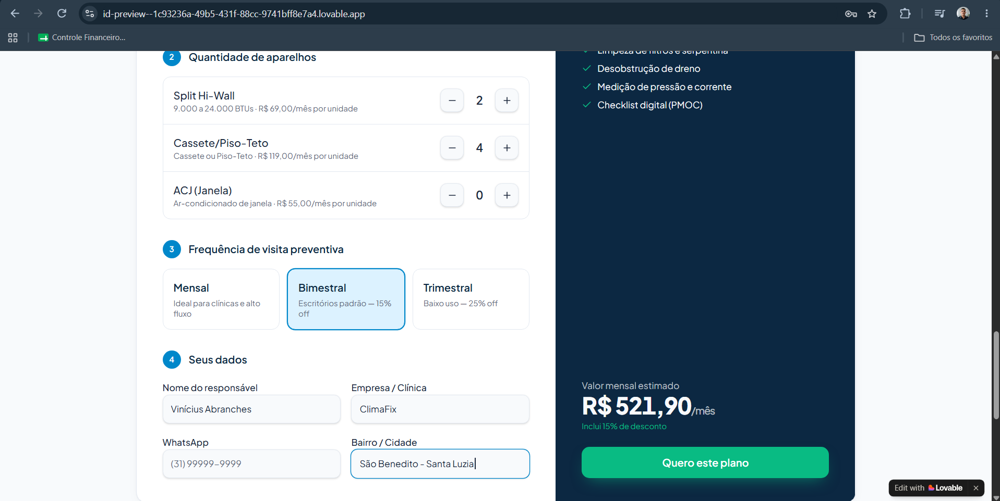
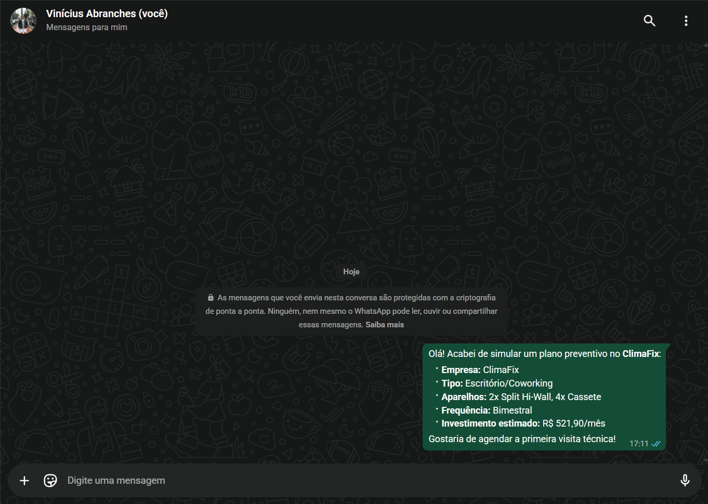
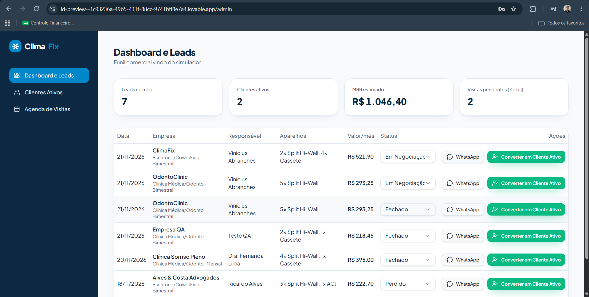

# ❄️ ClimaFix — Assinatura de Manutenção Preventiva de Ar-Condicionado (B2B)

> Projeto desenvolvido como desafio prático de **Vibe Coding** na **DIO (Digital Innovation One)**, indo da validação de uma dor real de mercado até um MVP funcional publicado com **Lovable + Lovable Cloud**.

🔗 **Aplicação Publicada (No Ar):** [Acessar ClimaFix Online](https://climafix-preventive-care.lovable.app)

---

## 1. A Dor Escolhida e Por Que Vale um Negócio
Clínicas médicas, consultórios odontológicos, academias e escritórios de pequeno porte sofrem com dois problemas críticos: **paradas inesperadas de climatização** em dias de calor intenso e o **risco de autuação pela Vigilância Sanitária** devido à falta de manutenção periódica e controle de PMOC (Plano de Manutenção, Operação e Controle).

Por outro lado, técnicos e empresas de refrigeração dependem de chamados corretivos imprevisíveis. O **ClimaFix** transforma a manutenção corretiva emergencial em um modelo de **receita recorrente (assinatura mensal)** com agendamento preventivo automático, checklist técnico digital e previsibilidade financeira para ambos os lados.

---

## 2. Tamanho de Mercado (TAM, SAM e SOM)
Estimativa baseada no mercado comercial brasileiro e na Região Metropolitana de Belo Horizonte (RMBH):
- **TAM (Mercado Total):** ~1,5 milhão de CNPJs comerciais, clínicas e escritórios no Brasil que operam com climatização comercial leve.
- **SAM (Mercado Endereçável):** ~12.000 clínicas médicas, odontológicas, estúdios e escritórios na Região Metropolitana de Belo Horizonte com 1 a 10 aparelhos (Split, Cassete e ACJ).
- **SOM (Mercado Obtível - 6 meses):** Captar 0,25% do SAM operando de forma enxuta = **30 clientes ativos** (ticket médio de R$ 280/mês = **R$ 8.400 de MRR**).

---

## 3. Business Model Canvas

| Bloco | Definição do MVP |
| :--- | :--- |
| **Segmentos de Clientes** | Clínicas médicas/odontológicas, escritórios, academias e comércios com 1 a 10 aparelhos de ar-condicionado. |
| **Proposta de Valor** | Climatização sempre funcionando, redução de até 30% no gasto energético e conformidade sanitária (checklist PMOC) sem precisar lembrar de agendar. |
| **Canais** | Landing Page com simulador online, WhatsApp comercial e prospecção ativa B2B local. |
| **Relacionamento** | Atendimento consultivo via WhatsApp e lembretes automáticos de ciclos preventivos (mensal, bimestral ou trimestral). |
| **Fontes de Receita** | Assinatura mensal recorrente calculada por quantidade e tipo de equipamento (Split Hi-Wall, Cassete/Piso-Teto e ACJ). |
| **Recursos Principais** | Aplicação web (Landing Page + Painel Admin via Lovable Cloud), ferramental técnico de refrigeração e insumos de higienização. |
| **Atividades-Chave** | Higienização química, limpeza de filtros/serpentinas, desobstrução de dreno, medição elétrica/pressão e emissão de relatório. |
| **Parcerias-Chave** | Fornecedores de insumos de refrigeração e engenheiros mecânicos responsáveis técnicos (ART para PMOC de maior porte). |
| **Estrutura de Custos** | Insumos químicos, deslocamento técnico, ferramentas e hospedagem da plataforma. |

---

## 4. Tese do MVP e Escopo Manual Intencional
- **Tese Testada:** *"Gestores de clínicas e escritórios preferem pagar uma mensalidade fixa e previsível com manutenção programada a arcar com custos altos e paradas emergenciais de chamados corretivos."*
- **O que ficou manual de propósito (Lean MVP):**
  - Fechamento comercial e alinhamento da primeira visita feitos manualmente via **WhatsApp**;
  - Envio do link de pagamento (Pix/Boleto recorrente) realizado após a confirmação da visita técnica;
  - Emissão do relatório técnico em PDF enviada após a conclusão do atendimento.

---

## 5. Estrutura do Repositório
- `README.md`: Documentação completa de produto, validação de mercado, Canvas e evidências.
- `docs/arquitetura.md`: Detalhamento da stack e estrutura de tabelas no Lovable Cloud.
- `01-landing-page.png` a `04-painel-admin.png`: Capturas de tela da aplicação em produção.

---

## 6. Evidências da Aplicação Funcionando

### Landing Page e Proposta de Valor

### Simulador Interativo de Assinatura

### Redirecionamento Automático para o WhatsApp

### Painel Administrativo (Leads, Clientes e Agenda)

---

## 7. Engenharia de Prompt e Vibe Coding (IA como Co-Founder)

### Mega Prompt Inicial (Lovable)
> *(# Projeto: ClimaFix — Assinatura de Manutenção Preventiva de Ar-Condicionado (B2B)

Atue como um Product Designer e Engenheiro Full-Stack Sênior. Crie um MVP completo, moderno e responsivo para o ClimaFix, um serviço de assinatura mensal de manutenção preventiva de ar-condicionado focado em clínicas, consultórios, academias e escritórios.

Ative e use o Lovable Cloud para persistência de dados (tabelas de leads, clients e appointments) e autenticação da área administrativa.

1. Identidade Visual e Design System:
- Estilo: Limpo, técnico, confiável e corporativo (SaaS B2B moderno).
- Paleta: Azul Profundo (#0F2942), Azul Ciano (#0284C7), Verde Esmeralda (#10B981) e Fundo Branco Gelo (#F8FAFC).

2. Fluxo do Cliente (Landing Page):
- Header com logo ClimaFix, links âncora e botão "Área do Técnico" (/admin).
- Hero Section com proposta de valor voltada para conformidade sanitária (PMOC), eficiência energética e zero paradas no calor.
- Simulador Interativo de Assinatura: seleção de tipo de estabelecimento, quantidade de aparelhos (Split Hi-Wall R$ 69/mês, Cassete/Piso-Teto R$ 119/mês, ACJ R$ 55/mês), frequência (Mensal 1.0x, Bimestral -15%, Trimestral -25%) e dados de contato.
- Ao submeter: salva na tabela leads como "Novo Lead" e abre modal com botão "Fechar Plano no WhatsApp" (https://wa.me/5531999999999?text=...) enviando o resumo estruturado do orçamento.

3. Painel de Administração (/admin):
- Protegido por login via Lovable Cloud, com 3 abas:
  - Dashboard e Leads: métricas (leads no mês, clientes ativos, MRR, visitas na semana), lista de leads, botão de WhatsApp e botão "Converter em Cliente Ativo" com 1 clique.
  - Clientes Ativos: gestão de assinantes, status da próxima manutenção e observações técnicas.
  - Agenda de Visitas: lista cronológica com botão "Concluir Manutenção" que recalcula automaticamente o próximo ciclo preventivo (30, 60 ou 90 dias).)*

### Validação e Ajustes Aplicados
- **Teste de Fluxo Externo (WhatsApp):** Identificado bloqueio de `X-Frame-Options` (`api.whatsapp.com`) ao testar dentro do iframe de preview do Lovable; validado em aba externa (`target="_blank"`), confirmando o envio automático dos dados estruturados do orçamento para o WhatsApp.
- **Segurança (RLS):** Revisão das políticas de banco de dados no Lovable Cloud para garantir inserção pública apenas na tabela de leads e leitura/gestão restrita a administradores autenticados.
